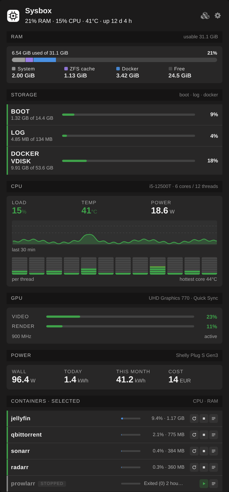
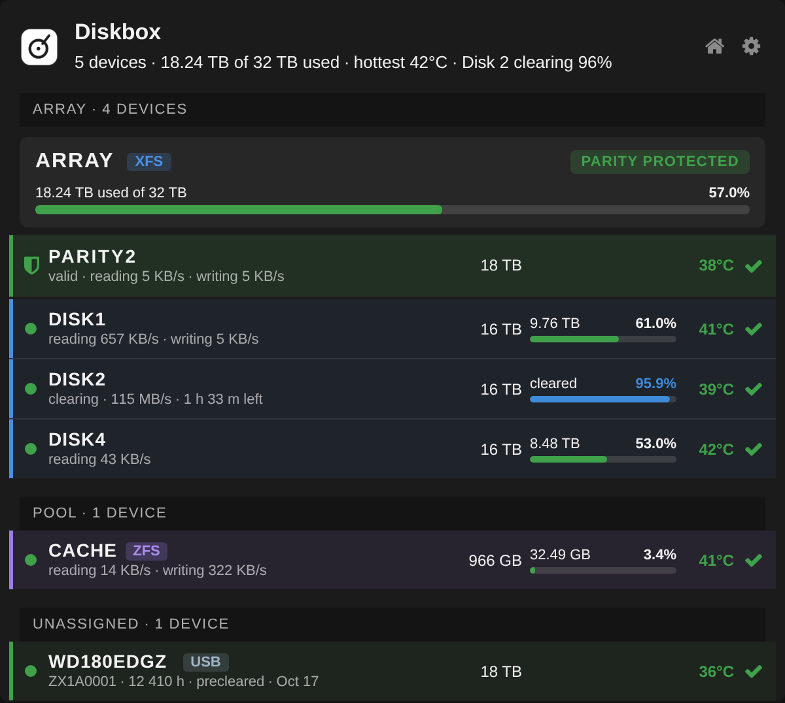
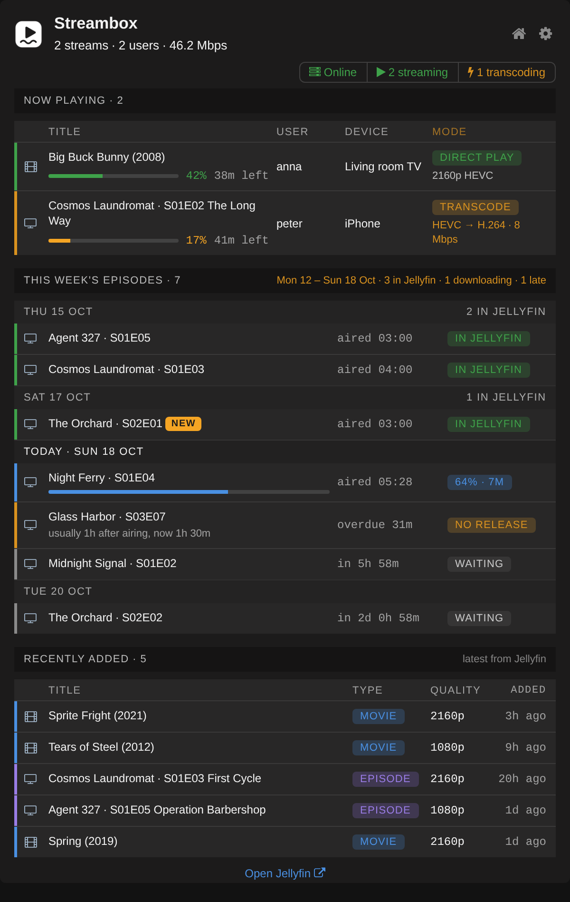
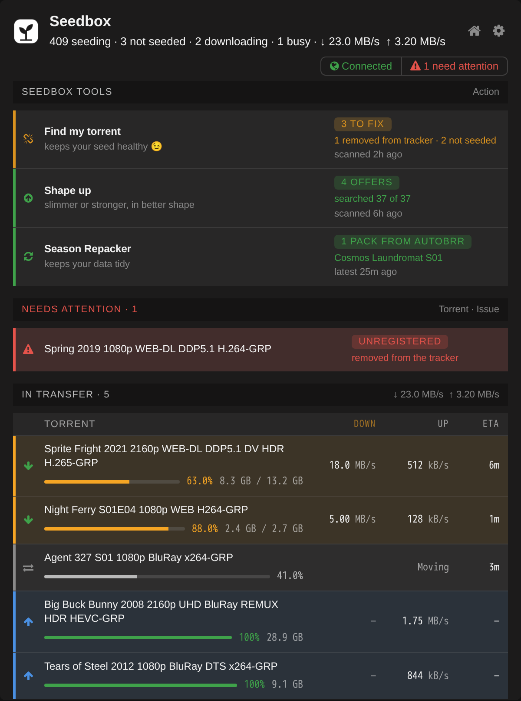
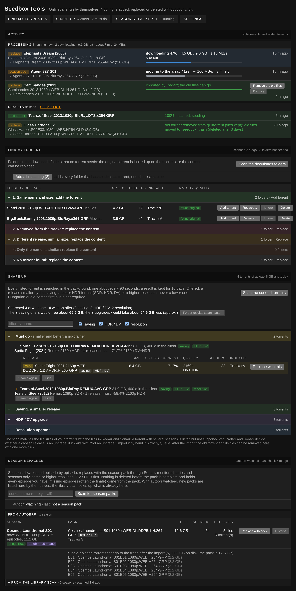

# unraid-mediaserver-tools

Dashboard plugins for **Unraid 7** (tested on **7.3.2**, see [Compatibility](#compatibility)) that help you run a media server (Jellyfin, qBittorrent, Radarr, Sonarr, Prowlarr, autobrr). They share one native-looking style, replace or extend the stock dashboard tiles, and need no extra containers.

**The rule of every tool here: nothing is added, replaced or deleted without your click.** The tools scan and report by themselves; every step that changes something is a button with a confirmation.

> The screenshots below are the real tiles and pages rendered with **made-up data** (no real titles, disks or users).

| Plugin | Replaces / adds | Highlights |
|---|---|---|
| [**Sysbox**](#sysbox) | System and Processor tiles | RAM, storage, CPU and GPU, wall power, containers; Update manager, Snapshots, Safe shutdown pages |
| [**Diskbox**](#diskbox) | Disk Viewer tile | Array, parity, pools, unassigned disks, SMART, preclear and clearing progress; **Balance** page: balance, empty or remove disks |
| [**Streambox**](#streambox) | new Jellyfin tile | Now playing, this week's episodes, recently added, Discord announcements |
| [**Seedbox**](#seedbox) | new qBittorrent tile and *Seedbox Tools* page | Find my torrent, Shape up, Season Repacker, autobrr watch, Discord bot |
| **Monitor** | Settings, Utilities, Monitor | The tiles in one column for the phone; reorder or hide them, add the page to the iPhone home screen |

## Sysbox



One tile instead of the System and Processor tiles: memory as one bar (system, ZFS cache, Docker, free), boot, log and Docker vdisk usage, CPU load with a 10 minute history, temperature and power, a per-thread heat map, the Intel GPU engines (Quick Sync), wall power from a Shelly smart socket with the monthly kWh, and the busiest or selected containers with start, stop, restart and log buttons. Anything that needs attention is listed at the top; Discord alerts with warning and critical limits you set.

Pages under *Settings, Utilities*:
- **Update manager**: every container with a waiting update, sorted *Wait*, *Look first* and *Safe* (rebuild, patch, feature or major change, from the image labels and the release notes), with a self-test of the services after an update.
- **Snapshots**: daily ZFS snapshots of the dataset that holds the containers' data, taken before the container updates and kept for a number of days.
- **Safe shutdown**: shows what could hang a shutdown (parity check, mover, Diskbox Balance, containers, VMs, processes with files open on the array) and stops the containers in a safe order with one button.

## Diskbox



A tile instead of Disk Viewer: the array as one card with its protection state, parity rows (amber during a check or rebuild, red when protection is lost), every data disk and pool with usage, temperature and SMART health, and the unassigned disks with their SMART self-test. A running UD Preclear and Unraid's clearing of a new data disk show step, speed and time left. A *Needs attention* list for full, hot or failing disks, and Discord alerts (also when a preclear or a SMART test ends).

### Diskbox Balance

*Settings, Utilities, Diskbox Balance.* Moves data between the array disks, in three modes:

- **Balance**: choose a target fill (or equal fill), get a plan, tick the titles, and move.
- **Empty disks**: tick the disk(s) to empty; everything in the configured folders is planned to the other disks: titles with their hardlinks, media files without a download (nfo, pictures, subtitles too) and the items in the Seedbox trash. The plan lists what would still stay on the disk.
- **Remove disks**: takes a disk out of the array without losing parity protection, step by step: the shares (you change them, Diskbox checks), emptying (the Empty disks plan), a check that nothing is left, clearing the disk through parity (zeros written to the array device, so parity stays valid; you type the disk names to start it, and the tile shows the progress), then the New Config steps in Unraid. No step can be skipped, and each one is checked again before the next.

A title is a downloads folder together with its hardlinked media files; they are copied with `rsync -aH`, checked (sizes and hardlinks) and only then removed from the old disk. Files hardlinked outside the configured folders, unfinished downloads and files changed in the last 2 hours are left out. Moves need the array started and no parity check, rebuild or mover running. The tile shows a running move with progress and time left, and Discord gets a message at the start, the end and on errors.

**Back up first and try it with one small title.**

## Streambox



Jellyfin at a glance: who is watching right now (direct play, direct stream or transcode, with progress), GPU and CPU load with the power draw, **this week's episodes** from the Sonarr calendar (air time, the usual delay until the release shows up, countdowns), and what was added recently. It can announce new movies and seasons in Discord, send a weekly summary, and put the week's episodes on Jellyfin's home page.

## Seedbox



A qBittorrent tile: connection state, torrents that need attention, what is in transfer right now with speeds, ETA and progress, and one row per Seedbox tool with its state. Idle seeds are never listed, so the tile stays short even with hundreds of torrents.

### Seedbox Tools

*Settings, Utilities, Seedbox Tools.* Helpers that work with qBittorrent, Prowlarr, Radarr, Sonarr and autobrr.



- **Find my torrent** scans your downloads folders for content that nothing is seeding and searches for it through Prowlarr. Results are sorted into categories: *same name and size* (add the torrent: qBittorrent checks it against your files and seeds it), *removed from the tracker*, *different release*, *only the name is similar* and *no torrent found* (replace the content through Radarr or Sonarr, or delete it).
- **Shape up** looks at your big, old seeded torrents for a release that is smaller, has a better HDR format or a higher resolution. *Must do* lists the no-brainers (smaller and better at the same time); the other offers are grouped by kind.
- **Season Repacker** finds the season pack for seasons whose episodes were downloaded one by one, checks that it holds every episode you have, lets Sonarr import it and seeds the pack instead of the single episodes. With **autobrr watch** a new season pack that autobrr lets through is offered by itself.
- **Replace** (used by all three): Radarr/Sonarr is asked for an equal or better release (same or higher resolution and HDR, closest in size, with seeders). After the import the old files go to a trash folder (deleted after a number of days you set) and the new release is seeded.
- **Activity** on top shows what is running now and what has finished; an item whose job has started leaves the result lists and comes back only if the job fails.
- **Scheduled scans** (daily or weekly) and **Discord**: summaries, torrents removed by their tracker, packs from autobrr. With the optional **Discord bot** you answer with a reaction (1, 2, 3 to pick a release, thumbs down to dismiss), and the message follows the job.

## Compatibility

| | |
|---|---|
| **Tested on** | **Unraid 7.3.2**, every plugin, in daily use on one server (Intel i5-12500T with Quick Sync, XFS array with two parity slots, one ZFS cache pool) |
| **Should work** | other Unraid 7 releases; the dashboard tiles use the Unraid 7 dashboard layout |
| **Not supported** | Unraid 6.x: never tried there, so the `.plg` files ask for 7.0.0 or newer (`min="7.0.0"`) and the Plugins page refuses them on 6.x |

Optional parts depend on what you have: Intel GPU engines (Sysbox, Streambox), a Shelly smart socket for wall power, Unassigned Devices and UD Preclear for the unassigned disks and the preclear progress (Diskbox), Radarr, Sonarr, Prowlarr and autobrr for the Seedbox Tools. If you run it on another release, an issue with the version and what you saw is welcome.

## Install

Unraid: *Plugins, Install Plugin*, paste the raw URL of the `.plg`:

```
https://raw.githubusercontent.com/leone007/unraid-mediaserver-tools/main/dist/sysbox.plg
https://raw.githubusercontent.com/leone007/unraid-mediaserver-tools/main/dist/streambox.plg
https://raw.githubusercontent.com/leone007/unraid-mediaserver-tools/main/dist/qbittorrent_widget.plg
https://raw.githubusercontent.com/leone007/unraid-mediaserver-tools/main/dist/diskbox.plg
https://raw.githubusercontent.com/leone007/unraid-mediaserver-tools/main/dist/mediaserver_monitor.plg
```

The `.plg` files are self-contained: all the code is embedded in them. Each plugin is independent; install only what you need. Seedbox is `qbittorrent_widget.plg` (its plugin id), Monitor is `mediaserver_monitor.plg`.

Updates: *Plugins, Check for updates* reads the `.plg` from this repository (`pluginURL` points at the raw file), so a new version shows up there once it is pushed.

## Layout

- `diskbox/`, `sysbox/`, `monitor/`: the sources of the plugin files and a `build.py` that writes `dist/<plugin id>.plg`
- `common/discord_tpl.php`: template of the Discord helper; `python3 tools/gen_discord.py` writes `diskbox/discord.php` and `sysbox/discord.php`
- `seedbox/`: sources plus `template.plg`, built by `python3 seedbox/build.py`
- `streambox/`: the files unpacked from the `.plg` for reading (`tools/extract_plg.py`); the `.plg` in `dist/` is the source of truth for Streambox
- `icons/`: plugin icons and the Discord webhook avatars
- `dist/`: the built plugins
- `tools/screenshots/`: renders the screenshots from the real pages with the made-up data in `mock/` (`sh tools/screenshots/shoot_all.sh`, needs php, node and Playwright)
- `NOTES.md`: development notes

## Build

```
python3 tools/gen_discord.py
python3 diskbox/build.py
python3 sysbox/build.py
python3 seedbox/build.py
python3 monitor/build.py
```

Streambox has no build script: edit the files in `streambox/` and run `python3 tools/patch_streambox_page.py <version> "<change>"`.

## Disclaimer

Use at your own risk. The Seedbox and Diskbox tools move and delete files; read what they will do before you click, and keep backups.

## License

MIT, see `LICENSE`.
