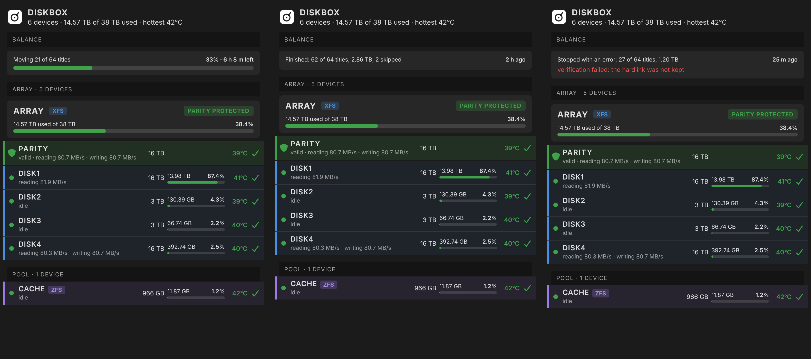

# unraid-mediaserver-tools

Dashboard plugins for **Unraid 7.x** that help you run a media server (Jellyfin, qBittorrent, Radarr, Sonarr, Prowlarr). They share one native-looking style, replace or extend the stock dashboard tiles, and need no extra containers.

> The screenshots below are **mockups with made-up data**, drawn to show the layout.

| Plugin | Replaces / adds | Highlights |
|---|---|---|
| [**Sysbox**](#sysbox) | System and Processor tiles | RAM breakdown, storage, CPU load / temperature / power, per-thread meters, GPU, containers, Discord alerts |
| **Monitor** | Settings → Utilities → Monitor | A phone-friendly page with the Sysbox, Diskbox, Streambox and Seedbox tiles in one column; reorder or hide tiles, add it to the iPhone home screen (install `mediaserver_monitor.plg`) |
| [**Streambox**](#streambox) | new Jellyfin tile | Now playing, recently added |
| [**Seedbox**](#seedbox) | new qBittorrent tile and *Seedbox Tools* page | Speeds, torrents; find torrents for unseeded files, replace content through Radarr/Sonarr |
| [**Diskbox**](#diskbox) | Disk Viewer tile | Array, parity, pools, SMART health, Discord alerts, **Balance** |

## Sysbox


One tile instead of the System and Processor tiles. Memory split into system, ZFS cache, Docker and free; boot, log and Docker vdisk usage; CPU load, temperature and power with a 10 minute history (green to yellow to red); per-thread meters; GPU load (Intel Quick Sync); selected containers; energy; Discord alerts with warning and critical limits you set.

## Streambox


Jellyfin at a glance: who is watching right now, and what was added recently (movies and episodes, with quality).

## Seedbox


A qBittorrent tile with speeds, ratio and the state of your torrents.

### Seedbox Tools

*Settings, Utilities, Seedbox Tools.* Two helpers that work with Prowlarr, Radarr and Sonarr. Nothing is added, replaced or deleted without your click.


- **Find my torrent** scans your downloads folders for content that nothing is seeding and searches for it through Prowlarr. Results are sorted into four groups:
  1. *Same name and size*: add the torrent. qBittorrent checks it against your files and seeds it (up to a few missing files are downloaded, for example an `.nfo`); otherwise it is removed again and your files stay untouched.
  2. *Different release, similar size*, 3. *only the name is similar*, 4. *no torrent found*: **replace the content** through Radarr or Sonarr.
- **Replace**: Radarr/Sonarr is asked for an equal or better release (same or higher resolution and HDR, closest in size, with seeders). After the import the old files go to a trash folder (deleted after a number of days you set) and the new release is seeded.
- **Update me** looks for smaller releases of big, old, seeded titles and replaces them after you approve.
- **Add all matching** adds every identical torrent, one check at a time.
- **Weekly check** (on by default) scans by itself, reports torrents removed by their tracker on Discord and flags them in the Seedbox tile under *Needs attention*.
- **Activity** shows what is *processing* now and what has *finished*; the scan list holds the work that is still to do. Optional Discord summaries say what happened and why.

## Diskbox

A tile instead of Disk Viewer: array fill, parity, pools, temperatures, SMART health and Discord alerts. The three tiles below show Balance running, finished and stopped with an error.



### Diskbox Balance

*Settings, Utilities, Diskbox Balance.* Choose a target fill (or equal fill), get a plan, tick the titles, and move. A title is a downloads folder together with its hardlinked media files; they are copied with `rsync -aH`, checked (sizes and hardlinks) and only then removed from the old disk. Files hardlinked outside the configured folders, unfinished downloads and files changed in the last 2 hours are left out. It needs the array started and no parity check, rebuild or mover running.

**Back up first and try it with one small title.**

## Install

Unraid: *Plugins, Install Plugin*, paste the raw URL of the `.plg`:

```
https://raw.githubusercontent.com/leone007/unraid-mediaserver-tools/main/dist/sysbox.plg
https://raw.githubusercontent.com/leone007/unraid-mediaserver-tools/main/dist/streambox.plg
https://raw.githubusercontent.com/leone007/unraid-mediaserver-tools/main/dist/qbittorrent_widget.plg
https://raw.githubusercontent.com/leone007/unraid-mediaserver-tools/main/dist/diskbox.plg
https://raw.githubusercontent.com/leone007/unraid-mediaserver-tools/main/dist/mediaserver_monitor.plg
```

The `.plg` files are self-contained: all the code is embedded in them. Each plugin is independent; install only what you need. Seedbox is `qbittorrent_widget.plg` (its plugin id), Monitor is `mediaserver_monitor.plg`.

Updates: *Plugins, Check for updates* reads the `.plg` from this repository (`pluginURL` points at the raw file), so a new version shows up there once it is pushed.

## Layout

- `diskbox/`, `sysbox/`, `monitor/`: the sources of the plugin files and a `build.py` that writes `dist/<plugin id>.plg`
- `common/discord_tpl.php`: template of the Discord helper; `python3 tools/gen_discord.py` writes `diskbox/discord.php` and `sysbox/discord.php`
- `seedbox/`: sources plus `template.plg`, built by `python3 seedbox/build.py`
- `streambox/`: the files unpacked from the `.plg` for reading (`tools/extract_plg.py`); the `.plg` in `dist/` is the source of truth for Streambox
- `icons/`: plugin icons and the Discord webhook avatars
- `dist/`: the built plugins
- `NOTES.md`: development notes

## Build

```
python3 tools/gen_discord.py
python3 diskbox/build.py
python3 sysbox/build.py
python3 seedbox/build.py
python3 monitor/build.py
```

Streambox has no build script: edit the files in `streambox/` and run `python3 tools/patch_streambox_page.py <version> "<change>"`.

## Disclaimer

Use at your own risk. The Seedbox and Diskbox tools move and delete files; read what they will do before you click, and keep backups.

## License

MIT, see `LICENSE`.
